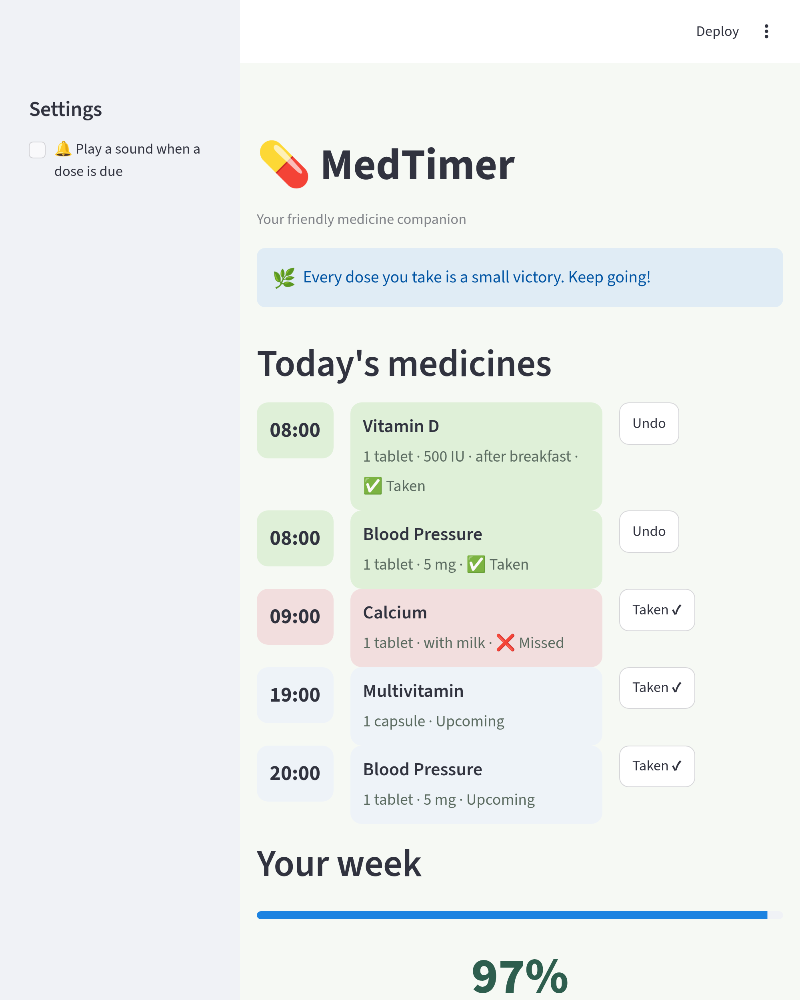
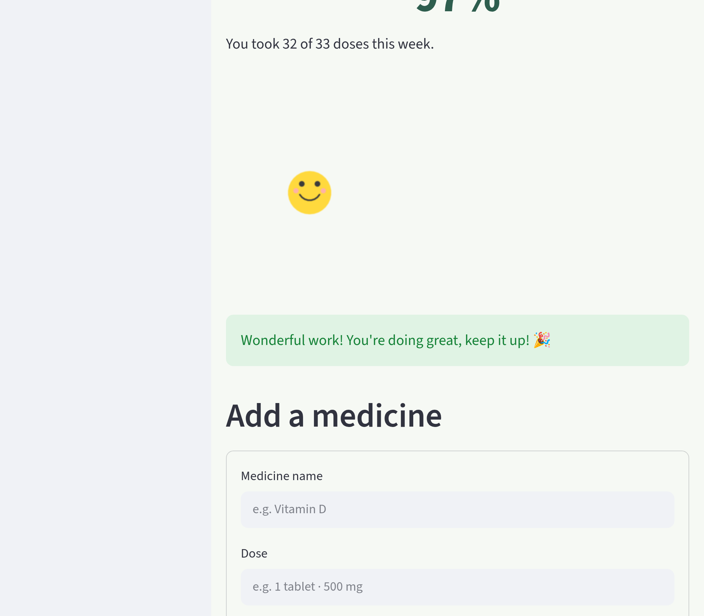
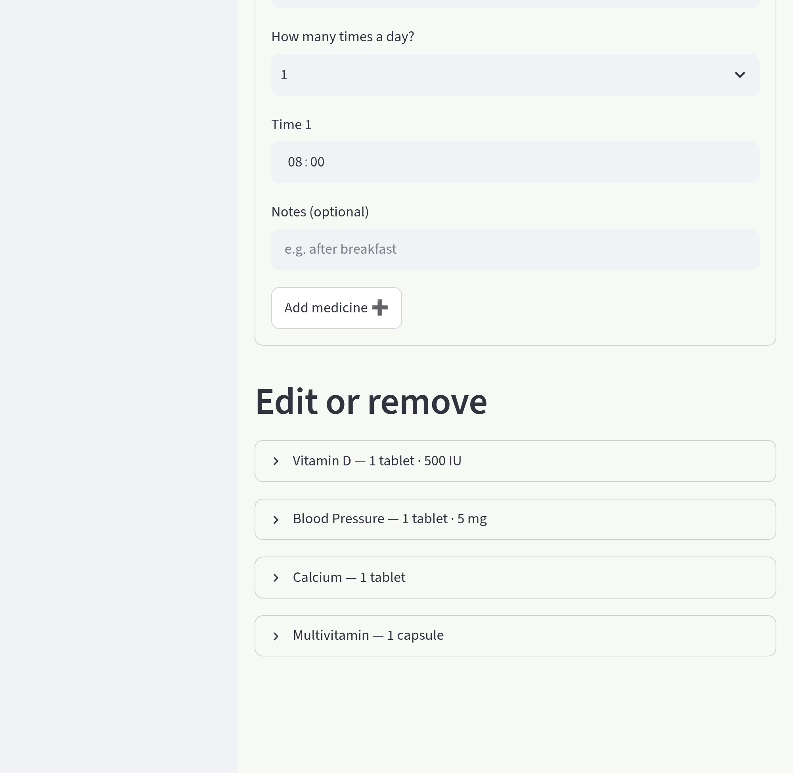

# 💊 MedTimer

A friendly medicine-reminder web app built for elderly people, with big text,
calm colours, a colour-coded daily checklist, a weekly adherence score and
reward artwork drawn with **Turtle graphics**.

Built with Python and [Streamlit](https://streamlit.io).

## Features

- **Add, edit and delete medicines** - name, dose, up to 4 times a day, and notes
  like "after breakfast".
- **Colour-coded daily checklist** - every dose for today, automatically marked:
  - 🟢 **Green** - taken
  - 🟡 **Yellow** - due now
  - 🔴 **Red** - missed (more than an hour late)
- **One-tap "Taken" button** for every dose (with Undo).
- **Weekly adherence score** - the percentage of doses taken over the last
  7 days, with a big easy-to-read display.
- **Turtle reward art** - a smiley drawn by `turtle_art.py` appears when the
  weekly score is 80% or more, and a trophy for a perfect 100% week.
- **Motivational quotes** - a new encouraging message every day.
- **Gentle sound reminder** - an optional beep when a dose is due
  (switch in the sidebar).
- **Elderly-friendly design** - large fonts, high contrast, calm green palette.
- **Automatic saving** - all data is stored in `data/medtimer_data.json`.

## Project structure

```
app.py            - the Streamlit app (run this)
turtle_art.py     - Turtle graphics that draw the smiley and trophy rewards
assets/           - the turtle-drawn artwork (PNG) and reminder beep
requirements.txt  - Python dependencies
data/             - created at runtime; holds the saved medicines and log
```

## Run it locally

```bash
pip install -r requirements.txt
streamlit run app.py
```

Then open http://localhost:8501 in a browser.

### Regenerating the Turtle artwork (optional)

The PNG rewards are already included in `assets/`. To draw them again with
Turtle you need Tkinter, ghostscript and a display (or Xvfb):

```bash
python turtle_art.py
```

The app falls back to the bundled PNGs if a live Turtle render is not possible
(for example on a server without a display).

## Deploying to Streamlit Cloud

1. Push this folder to a GitHub repository.
2. Go to https://share.streamlit.io and sign in with GitHub.
3. Click **New app**, pick the repository, branch `main`, file `app.py`.
4. Click **Deploy**. Your app gets a public link you can share.

## How the code is organised

- `app.py` keeps the data model simple: a list of medicines and a daily log,
  stored as JSON. `weekly_totals()` computes the adherence score, and
  `reward_image()` returns the Turtle-drawn artwork for a high score.
- `turtle_art.py` draws the smiley and trophy with the `turtle` module and
  exports them to PNG via PostScript and ghostscript.

## Screenshots

### Daily checklist



### Weekly adherence and Turtle reward



### Add, edit and delete medicines


